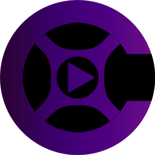

<div align="center">


# Stackarr

**Your media apps. One place to get started.**

Set up your home media server, connect your apps, and follow the journey from request to playback.

[](https://github.com/FrankieJLyons/Stackarr/releases/tag/v0.1.0)
[](https://github.com/FrankieJLyons/Stackarr/actions/workflows/ci.yml)
[](https://github.com/FrankieJLyons/Stackarr/actions/workflows/windows-preview.yml)
[](LICENSE)


[](docs/DOCKER-SETUP.md)


<br>

[](https://github.com/FrankieJLyons/Stackarr/releases/download/v0.1.0/Stackarr-0.1.0-Windows-x64.zip)

[Getting started](#-download-and-start) · [What’s included](#-included-in-this-beta) · [Beta checklist](docs/BETA-0.1.0.md) · [Roadmap](docs/ROADMAP.md) · [Report a bug](https://github.com/FrankieJLyons/Stackarr/issues/new?template=bug_report.md)

[Code signing policy](docs/CODE-SIGNING.md) · Signing application in preparation; current downloads are unsigned.

</div>

---

Stackarr helps set up and connect a home media server: Plex for watching, Seerr
for requests, and Sonarr, Radarr, Prowlarr and qBittorrent for finding and organizing
downloads. Choose what you need or connect apps you already run.

> [!NOTE]
> **0.1.0 is a public beta for Windows 11 x64 with Docker Desktop.** The download
> includes the launcher, dashboard and patched Seerr image. Python and a source
> checkout are not required. The executable is unsigned.

## ✨ Your apps, connected

| Watch & request | Find & organize | Download |
| :--- | :--- | :--- |
|  **Plex** · Watch your library<br>🎟️ **Seerr** · Request movies and shows |  **Sonarr** · TV shows<br> **Radarr** · Movies |  **Prowlarr** · Content sources<br> **qBittorrent** · Downloads |

**Optional companions:**  Tautulli for Plex activity ·  Uptime Kuma for monitoring ·  Cleanuparr for reviewed cleanup.

| 🧭 Guided setup | 🎛️ One control room | 🛡️ Review before changes |
| :--- | :--- | :--- |
| Choose your apps, folders and quality, then follow a saved checklist. | See app health, activity, media browsing and requests together. | Preview installation and maintenance actions, with encrypted configuration backups. |

## 🚀 Download and start

1. Download **Stackarr-0.1.0-Windows-x64.zip** from the
   [0.1.0 release](https://github.com/FrankieJLyons/Stackarr/releases/tag/v0.1.0).
   Choose that asset, rather than GitHub's source-code ZIP. A SHA-256 checksum is
   provided beside it.
2. Extract the complete ZIP into a new folder you intend to keep. Open
   **Start Stackarr.cmd**. Follow the Docker readiness steps; if prompted,
   complete Docker's installation and first start, then choose **Check again**.
3. Create your local Stackarr password. Choose **Watch my media**, **Movies & TV**,
   or customize your apps. Plex and content-provider accounts are separate.
4. Choose a media folder and movie/TV quality. Review the apps, folders and ports,
   then select **Download & install these apps**. Stackarr chooses available ports
   and separate app settings storage. Use an empty folder for your first test.
5. Follow the saved setup checklist. If using Plex, sign in and finish its server
   setup, skip adding libraries there, then return to Stackarr to prepare watching
   and requests. Review app connections and configure a content source you use.
6. Test a permitted movie or episode through request, download, import and playback
   on your viewing device. Existing media does not require a download source.

Keep the extracted package and your Stackarr data directory. Reopen **Start
Stackarr.cmd** after restarting Windows. Keep Stackarr and Docker running for
scheduled backups and automatic library discovery; the browser can close.
Do not extract an update over a running installation.

## 🧩 Included in this beta

- A media control room with app health, activity, browsing, requests and Plex links.
- Guided installation of the six core apps, with optional Tautulli, Uptime Kuma
  and Cleanuparr. Installation and maintenance actions require a review.
- Existing-app discovery and read-only native connection import. Connecting an
  app does not move its databases or media or give Stackarr lifecycle ownership.
- Independent app setup progress, generated logins and guided provider connections.
- Quality presets, year/title quality rules, download safeguards and library routing.
  Existing-title changes have separate preview/apply flows.
- Encrypted configuration backups, reviewed restore, owned-app repair/removal,
  pinned updates and rollback. Media files are excluded from configuration backups.
- Appearance settings, responsive layouts and contextual setup/help guidance.
- Experimental home-network HTTPS setup with a bundled gateway. Certificate trust
  is required once per device. Firewall access and startup remain host setup steps.

Cleanuparr starts in dry-run with automatic jobs off. Live cleanup requires a
separate preview and typed confirmation. Filtering is not an antivirus guarantee.

## 🧪 Beta limits

This is an early release for testing, not a certified unattended installation.
Fresh-Windows installation, reboot before sign-in, second-device certificate trust,
real provider/account variations and end-to-end playback still need user acceptance.
Linux source/Docker deployments are experimental; macOS, NAS and ARM installation
are not supported by the Windows package. Native app migration is not included.

Home-network access is experimental. Internet exposure and router changes are not
supported. Keep your configuration recovery key separately from backups and keep
independent backups of media. A successful installation does not mean every app
is connected or a title is ready to watch.

See the [beta acceptance checklist](docs/BETA-0.1.0.md),
[support matrix](docs/SUPPORT.md), [security policy](SECURITY.md) and
[third-party notices](docs/LICENSE-NOTES.md). Historical engineering reports in
`docs/` describe specific test builds and are not claims about every beta feature.

## 🛠️ Development

<details>
<summary><strong>Set up a development environment and run checks</strong></summary>

Use Python 3.12+ and Node.js 22+ for the JavaScript checks:

```text
python -m venv .venv
.venv/Scripts/activate
pip install -r requirements.lock
pip install pytest pytest-asyncio ruff pip-audit build playwright
python -m playwright install chromium
python -m ruff check stackarr tests tools
python -m pytest -q
node --test tests/*.test.cjs
python -m tools.audit_source --working-tree
python -m tools.browser_check
python -m pip_audit -r requirements.lock
python -m build
```

Run from source with `python -m stackarr.cli serve`, or see
[Docker setup](docs/DOCKER-SETUP.md). Tests must use synthetic data or isolated
installations; never point acceptance tests at a household stack.

</details>

## 🤝 Contribute & get help

Found a rough edge? [Report a bug](https://github.com/FrankieJLyons/Stackarr/issues/new?template=bug_report.md),
[suggest a feature](https://github.com/FrankieJLyons/Stackarr/issues/new?template=feature_request.md),
or work through the [beta checklist](docs/BETA-0.1.0.md). Include your version and reproduction steps; leave passwords and API keys out of reports.

[Contributing](CONTRIBUTING.md) · [Architecture](docs/ARCHITECTURE.md) ·
[Changelog](CHANGELOG.md) · [Publication process](docs/PUBLICATION.md)

---

<div align="center">

**Built for your home media server.**

[Apache 2.0](LICENSE) · [Security](SECURITY.md) · [Third-party notices](docs/LICENSE-NOTES.md)

<sub>App names and logos belong to their respective owners. Icons retain their <a href="stackarr/static/icons/LICENSE.txt">original license</a>.</sub>

</div>
